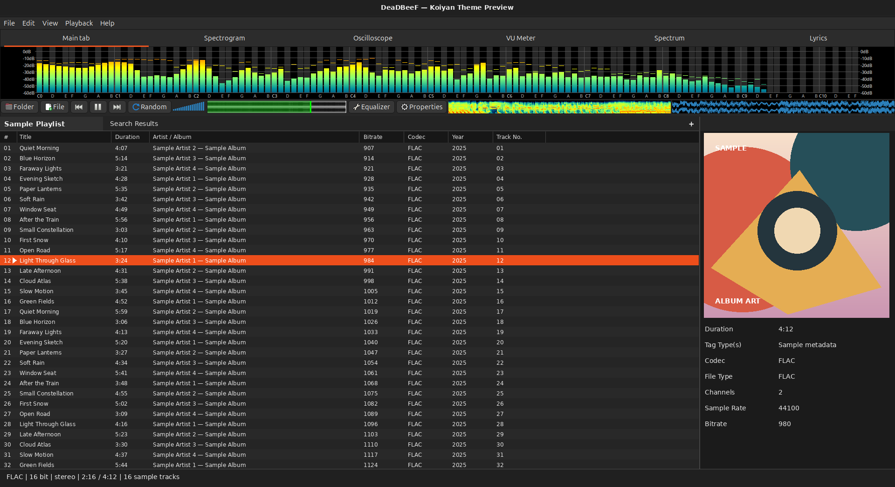

# Koiyan Theme for DeaDBeeF

A shareable, function-focused DeaDBeeF GTK UI layout configuration for Linux.

Koiyan is the author's nickname. This project emphasizes passionate music management by arranging DeaDBeeF and plugin-supported functionality on one screen, rather than decorative GTK theme customization.



## Source and scope

This theme fragment was curated from the DeaDBeeF configuration generated on a Linux system running DeaDBeeF 1.10.2. The original configuration lives at `~/.config/deadbeef/config`.

The fragment includes the six-tab layout, playlist and search columns, title-bar formatting, and waveform, spectrogram, and VU meter settings. It does not contain playlists, music paths, playback history, credentials, or machine-specific window geometry. DeaDBeeF's ordinary GTK controls continue to use the host desktop's GTK theme.

This is an independent community layout configuration, not an official DeaDBeeF theme, plugin, or fork.

## Requirements

- DeaDBeeF with the GTK UI. This configuration was captured from version 1.10.2; widget names or settings may vary across releases.
- The Linux builds of these visualizer plugins:
  - Musical Spectrum
  - Spectrogram
  - VU Meter
  - Waveform Seekbar

Get the plugins from the [official DeaDBeeF plugin page](https://deadbeef.sourceforge.io/plugins.html). Download the build matching your architecture and GTK UI, then extract it into `~/.local/lib/deadbeef/`. The plugin page lists the Linux downloads and installation instructions. Plugins are separate projects and retain their own licensing and copyright terms.

## Clone and apply

After publishing this folder to GitHub, replace `<owner>` with the account or organization that owns it, then clone it:

```sh
git clone https://github.com/<owner>/DeaDBeeF-config.git
cd DeaDBeeF-config
```

Then:

1. Install the required plugins and close DeaDBeeF.
2. From the cloned directory, run `sh ./apply.sh`.
3. Start DeaDBeeF again.

By default, the script merges only the theme keys into `~/.config/deadbeef/config`. It keeps unrelated settings and writes a timestamped backup beside the configuration first. For a non-default configuration location, pass its path explicitly: `sh ./apply.sh /path/to/deadbeef/config`.

To revert, close DeaDBeeF and copy the backup created by the script over the active `config` file.

The fragment describes DeaDBeeF's layout and visualizer colors; it does not install plugins or change the system-wide GTK theme.

## Attribution and license

Attribute the configuration to the **Koiyan Theme for DeaDBeeF project**, link to this repository, and identify changes when redistributing it. The original configuration and documentation in this repository are licensed under [CC BY 4.0](https://creativecommons.org/licenses/by/4.0/). This license does not cover DeaDBeeF or the separately downloaded plugins.
